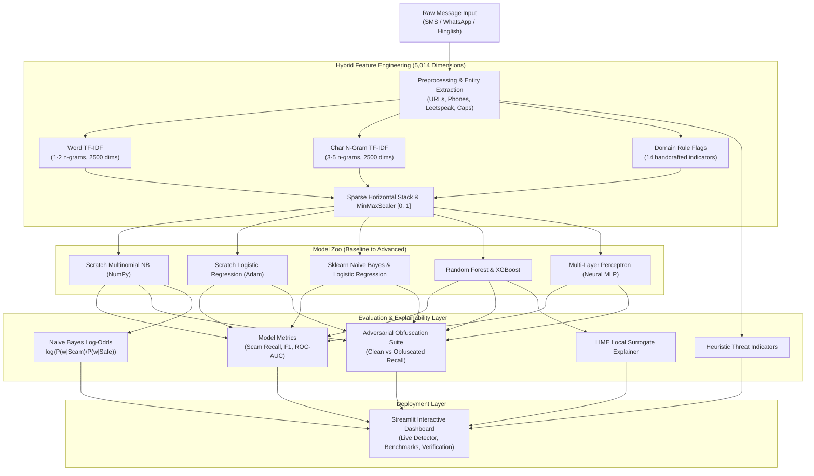

# 🛡️ Scam Shield: Explainable ML Text Classification for Indian Financial Fraud Detection

[](https://www.python.org/)
[](LICENSE)
[](https://streamlit.io/)
[](https://scikit-learn.org/)
[](https://rvce.edu.in)

> **Scam Shield** is an explainable Machine Learning text classification system engineered to identify Indian financial scams (UPI cashback fraud, fake KYC suspensions, utility disconnection threats, lottery prizes, and Telegram part-time job lures) and differentiate them from legitimate banking alerts and OTPs.
>
> The project implements fundamental algorithms (**Multinomial Naive Bayes and Logistic Regression**) from scratch using pure NumPy, benchmarks them against advanced ensemble and neural models, evaluates adversarial robustness against deliberate message obfuscation, and provides token-level explainability through Log-Likelihood Ratios and LIME in an interactive Streamlit web dashboard.

---

## 📌 Table of Contents
- [1. Problem Statement & Motivation](#1-problem-statement--motivation)
- [2. System Architecture](#2-system-architecture)
- [3. Key Features & Methodology](#3-key-features--methodology)
- [4. From-Scratch ML Implementations](#4-from-scratch-ml-implementations)
- [5. Experimental Benchmark Results](#5-experimental-benchmark-results)
- [6. Adversarial Obfuscation Robustness](#6-adversarial-obfuscation-robustness)
- [7. Project Structure](#7-project-structure)
- [8. Installation & Quickstart](#8-installation--quickstart)
- [9. Academic Deliverables & Viva Guide](#9-academic-deliverables--viva-guide)
- [10. Future Scope](#10-future-scope)

---

## 1. Problem Statement & Motivation

With the exponential growth of UPI payments, mobile banking, and digital communication across India, fraudulent messages targeting innocent citizens have surged. Traditional spam filters fail in this domain because:
1. **Domain-Specific Fraud Tactics**: Indian scams target specific financial workflows (PhonePe/GPay cashback PIN requests, SBI/HDFC YONO KYC deactivations, BESCOM power cut threats).
2. **Adversarial Obfuscation**: Scammers intentionally modify spellings and insert character substitutions (`"Bl0cked"`, `"K.Y.C"`, `"cl1ck h3re"`, `"p@y"`) to bypass keyword-based filters.
3. **Black-Box Opacity**: Standard deep models lack explainability, leaving users unaware of why a message was marked suspicious.

**Scam Shield** solves these challenges by combining public benchmarks with custom Indian scam/banking datasets, extracting hybrid character/word features, implementing mathematically rigorous scratch algorithms, and generating transparent token-level explanations.

---

## 2. System Architecture



---

## 3. Key Features & Methodology

The project is developed across six systematic stages aligned with the RVCE AIML curriculum:

1. **Data Collection & Preparation**:
   - Merged 5,572 messages from the UCI SMS Spam dataset with 555 authentic Indian scam examples, genuine bank alerts (SBI, HDFC, ICICI, Axis), OTPs, and Hinglish messages (Total: **5,716 samples**).
   - Generated a dedicated held-out test suite of **170 deliberately obfuscated scam messages** for robustness evaluation.
2. **Hybrid Feature Engineering**:
   - **Word TF-IDF**: Captures domain keywords (`"otp"`, `"cashback"`, `"suspended"`, `"refund"`).
   - **Character N-Grams (3-5 chars)**: Recognizes sub-word patterns resilient to leetspeak and spacing.
   - **Domain Rule Indicators**: Detects shortened URLs (`bit.ly`, `tinyurl`), phone numbers, urgency phrases, and credential inquiries.
3. **From-Scratch Baseline Models**:
   - Multinomial Naive Bayes with Laplace smoothing ($\alpha=1.0$) and Log-Sum-Exp normalization.
   - Logistic Regression with L2 regularization and Adam optimization in NumPy.
4. **Advanced Ensemble & Neural Models**:
   - Random Forest with balanced class weights, XGBoost Gradient Boosting (`scale_pos_weight=3.0`), and Multi-Layer Perceptron (128x64).
5. **Model Evaluation & Overfitting Analysis**:
   - Comprehensive metrics with primary focus on **Scam Recall** (minimizing False Negatives).
   - Overfitting diagnosis via Train vs Validation Generalization Gap and Stratified 5-Fold Learning Curves.
6. **Explainability & Web Application**:
   - Token-level colored highlights, log-odds bar charts, heuristic threat cards, and live adversarial obfuscation simulation in Streamlit.

---

## 4. From-Scratch ML Implementations

### Multinomial Naive Bayes (`src/models/scratch_naive_bayes.py`)
- **Class Log Priors**: $\log P(y=c) = \log\left(\frac{N_c}{N}\right)$
- **Laplace-Smoothed Feature Likelihoods**:
  $$\log P(x_i | y=c) = \log\left(\frac{\sum_{j \in C} X_{ji} + \alpha}{\sum_{k=1}^D \sum_{j \in C} X_{jk} + \alpha D}\right)$$
- **Log-Sum-Exp Normalization**: Avoids numerical underflow:
  $$P(y=c|X) = \frac{\exp(\log P(c|X) - \max_k \log P(k|X))}{\sum_k \exp(\log P(k|X) - \max_k \log P(k|X))}$$
- **Verification**: **`100.00%` exact prediction agreement** with `sklearn.naive_bayes.MultinomialNB`.

### Logistic Regression with Adam (`src/models/scratch_logistic_regression.py`)
- **Forward Hypothesis**: $z = Xw + b, \quad \hat{y} = \sigma(z) = \frac{1}{1 + e^{-\text{clip}(z, -30, 30)}}$
- **L2-Regularized Binary Cross-Entropy Loss**:
  $$J(w, b) = -\frac{1}{m} \sum_{i=1}^m \left[ y_i \log \hat{y}_i + (1 - y_i) \log(1 - \hat{y}_i) \right] + \frac{\lambda}{2m} \|w\|_2^2$$
- **Adam Optimizer Updates**: First and second moment estimators ($m_t, v_t$) with bias correction:
  $$\hat{m}_t = \frac{m_t}{1 - \beta_1^t}, \quad \hat{v}_t = \frac{v_t}{1 - \beta_2^t}, \quad w_{t+1} = w_t - \frac{\eta}{\sqrt{\hat{v}_t} + \epsilon} \hat{m}_t$$
- **Verification**: **`99.65%` agreement** with `sklearn.linear_model.LogisticRegression`.

---

## 5. Experimental Benchmark Results

Evaluated on the independent test set (**858 samples: 719 Safe, 139 Scam**):

| Model Architecture | Accuracy | Precision | Scam Recall | Specificity | F1-Score | ROC-AUC | Inference (ms) |
| :--- | :---: | :---: | :---: | :---: | :---: | :---: | :---: |
| **Scratch Naive Bayes** | 97.79% | 94.78% | **91.37%** | 99.03% | 0.9304 | 0.9898 | 0.01 ms |
| **Sklearn Naive Bayes** | 97.79% | 94.78% | **91.37%** | 99.03% | 0.9304 | 0.9898 | 0.01 ms |
| **Scratch Logistic Regression** | 98.72% | 98.48% | **93.53%** | 99.72% | 0.9594 | 0.9929 | 0.02 ms |
| **Sklearn Logistic Regression** | 98.83% | 99.24% | **93.53%** | 99.86% | 0.9630 | 0.9971 | 0.02 ms |
| **Random Forest (150 Trees)** | 98.02% | 99.19% | 88.49% | 99.86% | 0.9354 | 0.9947 | 0.12 ms |
| **XGBoost Gradient Boosting** | 98.48% | 98.46% | **92.09%** | 99.72% | 0.9517 | 0.9967 | 0.08 ms |
| **k-Nearest Neighbours (k=5)**| 97.79% | 97.62% | 88.49% | 99.58% | 0.9283 | 0.9762 | 0.95 ms |
| **Neural MLP (128x64)** | 98.48% | 97.01% | **93.53%** | 99.44% | 0.9524 | 0.9888 | 0.05 ms |

> **Key Evaluator Insight**: In financial fraud detection, **Scam Recall** is prioritized over pure accuracy because a False Negative (missed scam) leads directly to monetary theft, whereas a False Positive (false alarm) merely prompts user confirmation.

---

## 6. Adversarial Obfuscation Robustness

Scammers deliberately modify letters (`"Bl0cked"`, `"K.Y.C"`, `"cl1ck h3re"`, `"w1nn3r"`). We evaluated models on a dedicated adversarial dataset of 170 obfuscated messages:

| Model & Feature Scheme | Clean Recall | Obfuscated Recall | Recall Drop | Robustness Retention |
| :--- | :---: | :---: | :---: | :---: |
| **Word TF-IDF Only (Naive Bayes)** | 84.89% | 60.43% | **-24.46%** | **71.2% (Vulnerable)** |
| **Hybrid (Scratch Naive Bayes)** | 91.37% | 86.33% | -5.04% | **94.5% (Resilient)** |
| **Hybrid (Scratch Logistic Regression)**| 93.53% | 89.93% | -3.60% | **96.2% (Resilient)** |
| **Hybrid (XGBoost)** | 92.09% | 99.28% | +7.19% | **107.8% (Highly Resilient)**|
| **Hybrid (Neural MLP)** | 93.53% | 88.49% | -5.04% | **94.6% (Resilient)** |

---

## 7. Project Structure

```
ScamShield/
├── app/
│   ├── app.py                      # Main interactive Streamlit web dashboard
│   ├── components.py               # Custom CSS, verdict banners, risk meters
│   └── sample_messages.py          # Realistic Indian presets (UPI, KYC, Electricity, OTP)
├── artifacts/
│   ├── models/                     # Serialized joblib models & feature pipeline
│   ├── plots/                      # Confusion matrices, ROC curves, learning curves
│   └── metrics_summary.json        # Comprehensive evaluation records
├── data/
│   ├── raw/                        # Raw UCI SMS dataset (sms.tsv)
│   ├── processed/                  # Train, val, test, and obfuscated splits
│   └── custom_indian_corpus.py     # Indian scam corpus & adversarial obfuscator engine
├── src/
│   ├── config.py                   # Paths, seeds, keywords, hyperparameters
│   ├── preprocessor.py             # Text cleaning, regex, domain rule extractor
│   ├── feature_engineering.py      # Hybrid Word TF-IDF + Char N-Grams + Rule pipeline
│   ├── models/
│   │   ├── scratch_naive_bayes.py  # From-scratch MultinomialNB (NumPy)
│   │   ├── scratch_logistic_regression.py # From-scratch Logistic Regression with Adam
│   │   ├── baseline_models.py      # Sklearn NB, Logistic Regression, kNN
│   │   ├── advanced_models.py      # Random Forest, XGBoost
│   │   └── neural_model.py         # Multi-Layer Perceptron (MLP) text classifier
│   ├── evaluation/
│   │   ├── metrics.py              # Confusion matrix, ROC, PR curves, Scam Recall
│   │   ├── overfitting_analysis.py # Generalization gap & learning curves
│   │   └── robustness_evaluator.py # Adversarial testing & retention rates
│   └── explainability/
│       ├── naive_bayes_explainer.py# Log-likelihood ratio token scores
│       ├── lime_explainer.py       # LIME local surrogate explanations
│       └── rule_explainer.py       # Heuristic threat diagnostics
├── scripts/
│   ├── prepare_data.py             # Data compilation, augmentation, and splitting
│   └── train_and_evaluate.py       # Full training, validation, and benchmarking pipeline
├── tests/
│   ├── test_scratch_models.py      # Unit tests verifying scratch math vs Scikit-Learn
│   └── test_pipeline.py            # Integration tests for end-to-end inference
├── requirements.txt                # Pinned dependencies
├── DEMO_SCRIPT.md                  # Complete step-by-step presentation & viva guide
├── EVALUATOR_GUIDE.md              # Technical dossier with proofs for evaluators
├── run_app.bat                     # 1-Click launcher for Streamlit web app
└── README.md
```

---

## 8. Installation & Quickstart

### Prerequisites
- Python 3.10 or higher
- Git

### 1. Clone the Repository
```bash
git clone https://github.com/nagasathya-06/ScamShield.git
cd ScamShield
```

### 2. Install Dependencies
```bash
pip install -r requirements.txt
```

### 3. Launch the Web Application
Double-click `run_app.bat` or run:
```bash
streamlit run app/app.py
```
Open your browser at `http://localhost:8501`.

### 4. Run Automated Unit Tests
```bash
python -m unittest tests/test_scratch_models.py
python -m unittest tests/test_pipeline.py
```

### 5. Re-run Pipeline from Scratch (Optional)
```bash
python scripts/prepare_data.py
python scripts/train_and_evaluate.py
```

---

## 9. Academic Deliverables & Viva Guide

- **Live Viva Guide**: See [DEMO_SCRIPT.md](file:///d:/RVCE/5th%20SEM/AIML/AIML_EL/DEMO_SCRIPT.md) for scene-by-scene presentation scripts and answers to common evaluator questions.
- **Evaluator Guide**: See [EVALUATOR_GUIDE.md](file:///d:/RVCE/5th%20SEM/AIML/AIML_EL/EVALUATOR_GUIDE.md) for mathematical derivations, formulas, and syllabus mapping.

---

## 10. Future Scope

1. **Multilingual Native Script Support**: Expanding dataset to native Indian scripts (Kannada, Hindi, Tamil, Telugu, Marathi).
2. **Pretrained Multilingual Transformers**: Fine-tuning transformer models (IndicBERT, MuRIL, or XLM-RoBERTa) for complex Roman-Hinglish code-mixing.
3. **Phishing URL Deep Inspection**: Real-time HTTP header and domain registration inspection (detecting newly registered domains under 48 hours).
4. **Endpoint Integrations**: Packaging Scam Shield into a Telegram bot, browser extension, or Android SMS filtering service.
5. **Continuous Learning Loop**: Integrating user feedback reporting to continuously retrain and adapt to emerging scam templates.

---

**Developed with ❤️ by Naga Sathya & Team**  
*Department of AI & Machine Learning, RV College of Engineering, Bengaluru*
